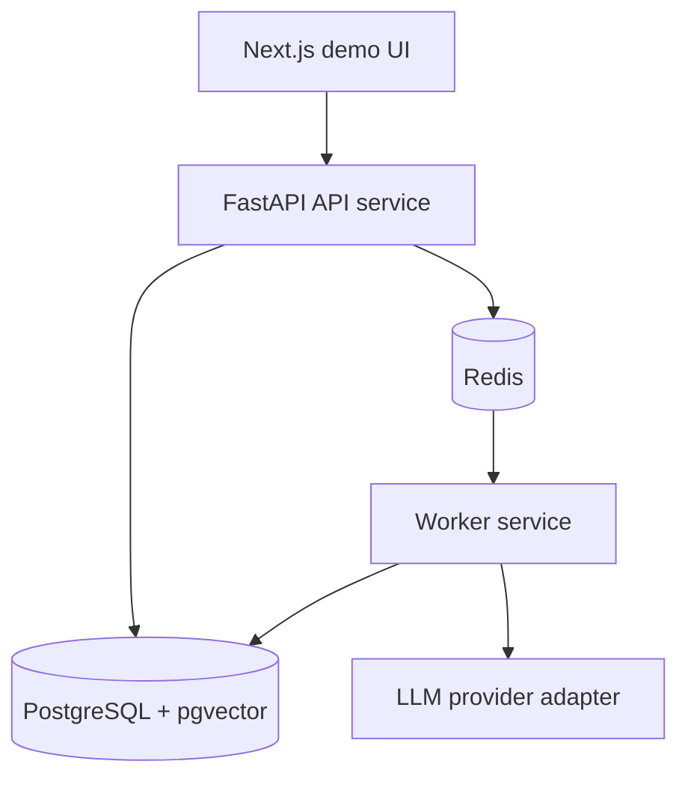

# CareerOps AI

CareerOps AI is a backend-first project for matching internship job requirements against a student's real experience evidence. The product uses AI, but the engineering focus is reliability: asynchronous work, idempotency, database constraints, caching, observability, and repeatable tests.

## Current Status

This repository has a backend-first FastAPI foundation with health endpoints, local PostgreSQL and Redis dependencies, strict typing, import boundary checks, CI scaffolding, email/password authentication, signed access tokens, a reusable current-user dependency, user-owned Experiences and Jobs CRUD, and worker-backed idempotent parse runs that turn immutable JD snapshots into grounded structured requirements through a fake or Groq adapter.

## Architecture Direction



The API service will never call the LLM directly. Model calls belong in the worker so request latency stays predictable and tests can replace the provider with a fake implementation.

## Local Setup

Create a project-local virtual environment:

```powershell
python -m venv .venv
.\.venv\Scripts\python -m pip install -e ".[dev,worker]"
```

Run the API through the virtual environment:

```powershell
.\.venv\Scripts\uvicorn careerops.main:create_app --factory --reload
```

Start local infrastructure:

```powershell
docker compose up -d postgres redis
```

Run the worker in a separate terminal:

```powershell
.\.venv\Scripts\dramatiq careerops.workers.tasks --processes 1 --threads 4
```

The checked-in `.env.example` defaults to the deterministic `fake` provider.
To run Groq locally, copy the example to the ignored `.env`, set
`CAREEROPS_LLM_PROVIDER=groq`, and add `CAREEROPS_LLM_API_KEY`. Never commit the
key. Automated tests remain fake or mock-backed unless the live-test flag is
explicitly enabled.

Recover queued work and stale running work from PostgreSQL:

```powershell
.\.venv\Scripts\python -m careerops.workers.recovery
```

Apply database migrations:

```powershell
.\.venv\Scripts\alembic upgrade head
```

Useful checks:

```powershell
.\.venv\Scripts\python -m pytest
.\.venv\Scripts\python -m mypy
.\.venv\Scripts\ruff check .
.\.venv\Scripts\lint-imports
```

Run the small real-provider compatibility test intentionally:

```powershell
$env:CAREEROPS_RUN_LLM_INTEGRATION='1'
.\.venv\Scripts\python -m pytest tests/integration/test_groq_live.py -s
Remove-Item Env:CAREEROPS_RUN_LLM_INTEGRATION
```

Using the explicit `.venv` paths keeps project dependencies out of the global Python or Anaconda environment.

## API Surface

- `GET /healthz` checks whether the API process is alive.
- `GET /readyz` checks whether required dependencies are reachable.
- `POST /api/v1/auth/register` creates a user with a hashed password.
- `POST /api/v1/auth/login` verifies credentials and returns a bearer access token.
- `GET /api/v1/auth/me` returns the current user for a valid bearer access token.
- `GET /api/v1/experiences` lists the current user's active experiences.
- `POST /api/v1/experiences` creates an experience owned by the current user.
- `GET /api/v1/experiences/{id}` returns one owned active experience.
- `PATCH /api/v1/experiences/{id}` updates one owned active experience with `If-Match` optimistic locking.
- `DELETE /api/v1/experiences/{id}` soft-deletes one owned active experience.
- `GET /api/v1/jobs` lists the current user's active jobs with optional status filtering and cursor pagination.
- `POST /api/v1/jobs` creates a target job description owned by the current user.
- `GET /api/v1/jobs/{id}` returns one owned active job.
- `PATCH /api/v1/jobs/{id}` updates one owned active job with `If-Match` optimistic locking.
- `DELETE /api/v1/jobs/{id}` soft-deletes one owned active job.
- `POST /api/v1/jobs/{id}/parse-runs` creates or reuses a queued idempotent parse run for one owned active job; a key can be replayed only while that job's parse input is unchanged.
- `GET /api/v1/jobs/{id}/parse-runs/{run_id}` returns one owned parse run with structured requirements.

Remaining business endpoints will be added in small milestones: evidence-backed analysis runs, action items, and dashboard summary.

## Key Decisions

- Python is used with strict typing discipline because the project targets backend systems plus LLM governance, not a language showcase.
- PostgreSQL is the only source of truth. Redis may be cleared and rebuilt.
- Dramatiq is the worker queue because its Redis integration is small and direct for this project size. PostgreSQL remains the durable task source and can rebuild queued delivery.
- Database constraints will enforce core invariants, especially the rule that positive evidence matches cannot be stored without real evidence.
