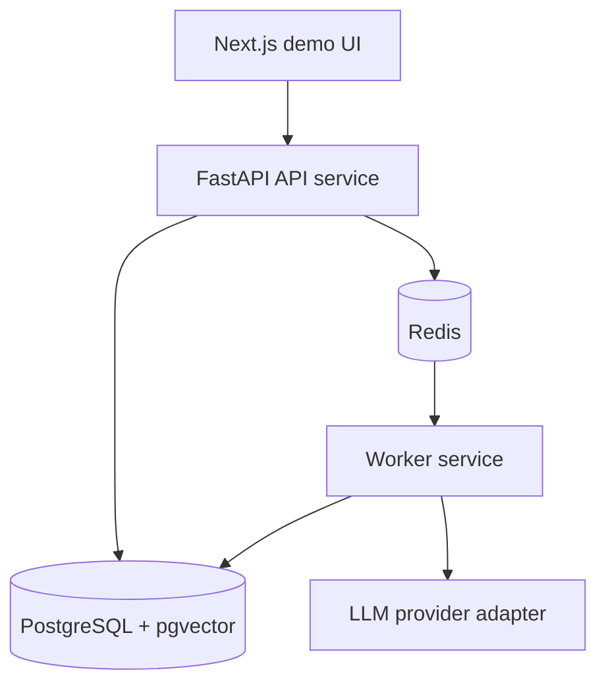

# CareerOps AI

CareerOps AI is a backend-first project for matching internship job requirements against a student's real experience evidence. The product uses AI, but the engineering focus is reliability: asynchronous work, idempotency, database constraints, caching, observability, and repeatable tests.

## Current Status

This repository has a backend-first FastAPI API, PostgreSQL and Redis, signed
authentication, user-owned Experiences and Jobs, and independent workers for
parsing, embeddings, and Analysis Runs. Analysis uses frozen lexical plus exact
pgvector hybrid retrieval with deterministic weighted RRF, provenance fencing,
and lexical fallback. PostgreSQL remains authoritative and Redis is disposable.

P1-5 now includes a typed real-matcher contract, prompt-v4 Groq adapter, rubric-v2
development and holdout evaluation, and controlled worker integration. The
one-time eight-case matcher holdout passed every pre-frozen evidence-integrity
safety gate: schema 8/8, zero provider/output failures, grounded citations 1/1,
zero unsupported positives, zero `gap -> positive`, and zero
`partial -> matched`. Matcher-only coverage was 6/8 and both partial cases were
missed as gaps. Those quality limits remain explicit; the holdout is closed and
must not be rerun or used for tuning.

New Analysis Runs bind matcher model, prompt/schema version, and retrieval space
before queueing. The API still never calls a model. The worker resolves the
adapter from the durable work item, verifies output identity, validates every
positive against ownership, Top-5 candidacy, Experience version, source, and
quote, and persists the complete result atomically. Specific provider/output
failures remain durable failures and never silently fall back to fake.

The deterministic fake matcher remains the default for CI and local work. Real
worker access is restricted to frozen prompt v4 and `openai/gpt-oss-20b`, and
requires an invocation-local process gate plus the provider key. Historical
development reports remain unchanged, including the original failed quality
gates and the author-accepted conservative prompt-v4 limitation.

## Architecture Direction



The API service will never call the LLM directly. Model calls belong in the worker so request latency stays predictable and tests can replace the provider with a fake implementation.

## Local Setup

Create a project-local virtual environment:

```powershell
python -m venv .venv
.\.venv\Scripts\python -m pip install -e ".[dev,worker]"
```

Run the API through the virtual environment:

```powershell
.\.venv\Scripts\uvicorn careerops.main:create_app --factory --reload
```

Start local infrastructure:

```powershell
docker compose up -d postgres redis
```

Run the worker in a separate terminal:

```powershell
.\.venv\Scripts\dramatiq careerops.workers.tasks --processes 1 --threads 4
```

Embedding and hybrid retrieval default to the deterministic fake provider. A local
Gemini worker requires `CAREEROPS_EMBEDDING_PROVIDER=gemini`, an ignored
`CAREEROPS_GEMINI_API_KEY`, and a process-only live gate that is never read from
`.env`:

```powershell
$env:CAREEROPS_RUN_EMBEDDING_INTEGRATION = "1"
try { .\.venv\Scripts\dramatiq careerops.workers.tasks --processes 1 --threads 4 }
finally { Remove-Item Env:CAREEROPS_RUN_EMBEDDING_INTEGRATION -ErrorAction SilentlyContinue }
```

The API still only schedules durable work; provider calls occur in the worker.

The checked-in `.env.example` defaults to the deterministic `fake` provider.
To run Groq locally, copy the example to the ignored `.env`, set
`CAREEROPS_LLM_PROVIDER=groq`, and add `CAREEROPS_LLM_API_KEY`. Never commit the
key. Automated tests remain fake or mock-backed unless the live-test flag is
explicitly enabled.

Evidence matching is configured independently from requirement parsing. Setting
`CAREEROPS_EVIDENCE_MATCHER_PROVIDER=groq` in the API process binds newly
submitted Analysis Runs to the frozen Groq matcher. It does not make a network
call. The worker additionally requires the process-only live gate:

```powershell
$env:CAREEROPS_RUN_REAL_MATCHER_WORKER = "1"
try { .\.venv\Scripts\dramatiq careerops.workers.tasks --processes 1 --threads 4 }
finally { Remove-Item Env:CAREEROPS_RUN_REAL_MATCHER_WORKER -ErrorAction SilentlyContinue }
```

The key may be loaded from the ignored `.env`, but putting the live gate there
does not authorize execution because the resolver reads it directly from the
worker process environment. Stop other unauthorized Analysis workers before
processing Groq-bound jobs; otherwise they will correctly claim and fail those
jobs as disabled. Each real matcher execution makes one HTTP attempt. A timeout,
429, 5xx, invalid JSON, invalid schema, or invalid contract becomes a durable
failure; there is no fake fallback or claimed process-wide TPM smoothing.

New Analysis Runs are admitted through a per-user Redis sliding window before a
durable row or queue message is created. The default allows five new runs per
hour. A valid `Idempotency-Key` replay returns its existing run without consuming
another slot. Rejection returns `429 ANALYSIS_RATE_LIMITED` with `Retry-After`;
Redis admission failure returns 503 instead of silently disabling cost
protection. Configure the window with `CAREEROPS_ANALYSIS_RATE_LIMIT` and
`CAREEROPS_ANALYSIS_RATE_LIMIT_WINDOW_SECONDS`.

Recover queued work and stale running work from PostgreSQL:

```powershell
.\.venv\Scripts\python -m careerops.workers.recovery
.\.venv\Scripts\python -m careerops.workers.analysis_recovery
.\.venv\Scripts\python -m careerops.workers.embedding_recovery
```

Apply database migrations:

```powershell
.\.venv\Scripts\alembic upgrade head
```

Useful checks:

```powershell
.\.venv\Scripts\python -m pytest
.\.venv\Scripts\python -m mypy
.\.venv\Scripts\ruff check .
.\.venv\Scripts\lint-imports
```

Run the small real-provider compatibility test intentionally:

```powershell
$env:CAREEROPS_RUN_LLM_INTEGRATION='1'
.\.venv\Scripts\python -m pytest tests/integration/test_groq_live.py -s
Remove-Item Env:CAREEROPS_RUN_LLM_INTEGRATION
```

Run the labeled development-set evaluation intentionally, always choosing a new
output filename so historical evidence remains intact:

```powershell
.\.venv\Scripts\python -m careerops.evaluation.run_requirement_parser `
  --dataset evals/job_requirements_v1.json `
  --output docs/metrics/YYYY-MM-DD-groq-requirement-eval.json `
  --git-revision <commit-or-working-tree-label>
```

Evaluate the current lexical evidence retriever offline, again choosing a new
output filename for every saved comparison:

```powershell
.\.venv\Scripts\python -m careerops.evaluation.run_evidence_retrieval `
  --dataset evals/evidence_retrieval_v1.json `
  --output docs/metrics/YYYY-MM-DD-lexical-retrieval-baseline.json `
  --git-revision <commit-or-working-tree-label>
```

Run retrieval evaluation v2 only with the approved manifest and development split:

```powershell
.\.venv\Scripts\python -m careerops.evaluation.run_evidence_retrieval_v2 `
  --experiences evals/evidence_retrieval_v2/experiences.json `
  --queries evals/evidence_retrieval_v2/development_queries.json `
  --review-manifest evals/evidence_retrieval_v2/review_manifest.json `
  --output docs/metrics/YYYY-MM-DD-lexical-retrieval-v2-development.json `
  --git-revision <commit-or-working-tree-label>
```

The command rejects holdout queries. Keep the holdout sealed until lexical, vector,
and hybrid candidates and parameters are frozen for their one-time comparison.

After author approval of rubric v2, run the development split with the
deterministic fake matcher:

```powershell
.\.venv\Scripts\python -m careerops.evaluation.run_evidence_matcher `
  --experiences evals/evidence_retrieval_v2/experiences.json `
  --cases evals/evidence_matcher_v1/development_cases.json `
  --review-manifest evals/evidence_matcher_v1/review_manifest.json `
  --output docs/metrics/YYYY-MM-DD-fake-evidence-matcher-development.json `
  --git-revision <commit-or-working-tree-label>
```

The checked-in manifest is `approved_frozen` for development hash
`c8c3d535ae103ea21b4c24397e1021dc4fd7688b37f907563363a19d87329605`.
Hash validation prevents changed labels from reusing that approval. The
development runner always rejects matcher holdout, and manifest approval alone
does not authorize a provider request.

Reproduce the rubric-v2 offline rescore from saved raw development output without
a provider call:

```powershell
.\.venv\Scripts\python -m careerops.evaluation.run_evidence_matcher_rescore `
  --experiences evals/evidence_retrieval_v2/experiences.json `
  --cases evals/evidence_matcher_v1/development_cases.json `
  --source-report docs/metrics/2026-10-04-groq-evidence-matcher-development-recovery.json `
  --output docs/metrics/YYYY-MM-DD-groq-evidence-matcher-offline-rescore.json `
  --git-revision <commit-or-working-tree-label>
```

The rescorer accepts development data only, refuses overwrite, records zero
provider attempts, and does not require or imply holdout access.

Derive coverage and directional safety metrics from an immutable development
report without calling a provider:

```powershell
.\.venv\Scripts\python -m careerops.evaluation.run_evidence_matcher_coverage_rescore `
  --experiences evals/evidence_retrieval_v2/experiences.json `
  --cases evals/evidence_matcher_v1/development_cases.json `
  --source-report docs/metrics/2026-10-04-groq-evidence-matcher-development-prompt-v2.json `
  --output docs/metrics/YYYY-MM-DD-evidence-matcher-coverage.json `
  --git-revision <commit-or-working-tree-label>
```

For user-facing explanations, say that current materials fully demonstrate,
partly demonstrate, or do not yet demonstrate a requirement. A missing resume
claim is not proof that the user lacks the ability. Suggest adding concrete
details only when the user genuinely performed the work; never suggest inventing
an Experience, technology, metric, or result.

Run a separately authorized, bounded Groq development evaluation only with an
invocation-local opt-in:

```powershell
$env:CAREEROPS_RUN_MATCHER_EVAL = "1"
.\.venv\Scripts\python -m careerops.evaluation.run_real_evidence_matcher `
  --experiences evals/evidence_retrieval_v2/experiences.json `
  --cases evals/evidence_matcher_v1/development_cases.json `
  --review-manifest evals/evidence_matcher_v1/review_manifest.json `
  --run-manifest evals/evidence_matcher_v1/prompt_v4_selected_development_manifest.json `
  --output docs/metrics/YYYY-MM-DD-groq-evidence-matcher-development.json `
  --git-revision <commit-or-working-tree-label>
```

The runner is fixed to `openai/gpt-oss-20b`, one attempt per case, at most 12
provider attempts, and an 800-token output ceiling. It refuses output overwrite
and the matcher holdout. No further development run is currently approved; the
command documents the frozen invocation rather than inviting another sample.
The 2026-10-04 run exhausted its budget with six durable
rate-limit failures; do not rerun the command as recovery because it would recall
the six successful cases.

The confirmed cause was the model's rolling 8K TPM limit, not TPD or monthly
exhaustion: the first six successes reported 7,648 tokens while requests were sent
in about nine seconds, and the account showed only about 8.2K daily tokens against
the 200K TPD allowance. Recovery therefore paces requests instead of changing the
frozen model, prompt, matcher labels, or retrieval parameters.

After separate authorization, recover only those failures with a new artifact:

```powershell
$env:CAREEROPS_RUN_MATCHER_EVAL = "1"
.\.venv\Scripts\python -m careerops.evaluation.run_real_evidence_matcher `
  --experiences evals/evidence_retrieval_v2/experiences.json `
  --cases evals/evidence_matcher_v1/development_cases.json `
  --review-manifest evals/evidence_matcher_v1/review_manifest.json `
  --resume-from docs/metrics/2026-10-04-groq-evidence-matcher-development.json `
  --output docs/metrics/YYYY-MM-DD-groq-evidence-matcher-development-recovery.json `
  --git-revision <commit-or-working-tree-label>
```

Recovery hash-validates the original report, calls only failed case IDs, limits
the new budget to their count, spaces requests by at least 11 seconds, and carries
successful prior results into the new report. It still rejects holdout input.

The authorized 2026-10-04 recovery used all six allowed requests and completed
without failure. The merged development result is documented under
`docs/metrics/2026-10-04-groq-evidence-matcher-development-recovery.md`. Do not
repeat the recovery: there are no failed cases left, and the runner will reject a
prior report with nothing to recover.

The later prompt-v2 development report is documented in
`docs/metrics/2026-10-04-groq-evidence-matcher-development-prompt-v2.md`. It has
one `invalid_schema` case and did not pass the frozen gates. Do not run another
fresh development pass or recover that case without separate authorization; no
matcher holdout run is authorized.

The one-time matcher holdout used a separate runner and opt-in. The command below
is retained only to document the frozen invocation; the holdout completed on
2026-10-05 and must not be run again:

```powershell
$env:CAREEROPS_RUN_MATCHER_HOLDOUT = "1"
.\.venv\Scripts\python -m careerops.evaluation.run_evidence_matcher_holdout `
  --experiences evals/evidence_retrieval_v2/experiences.json `
  --development-cases evals/evidence_matcher_v1/development_cases.json `
  --holdout-cases evals/evidence_matcher_v1/holdout_cases.json `
  --manifest evals/evidence_matcher_v1/holdout_v2_run_manifest.json `
  --selected-development-manifest evals/evidence_matcher_v1/prompt_v4_selected_development_manifest.json `
  --development-report docs/metrics/2026-10-05-groq-evidence-matcher-development-prompt-v4.json `
  --development-coverage-report docs/metrics/2026-10-05-groq-evidence-matcher-development-prompt-v4-coverage-v2-gates-v4.json `
  --checkpoint docs/metrics/2026-10-05-groq-evidence-matcher-holdout-checkpoint.json `
  --output docs/metrics/2026-10-05-groq-evidence-matcher-holdout.json `
  --git-revision <commit-or-working-tree-label>
```

The manifest freezes eight request slots, one attempt per case, prompt v4, Groq
`openai/gpt-oss-20b`, at least 11 seconds between requests, and the coverage-v2
evaluator. Resume skips completed cases. A case that was in progress during a
local interruption becomes an explicit indeterminate provider failure and is not
called again. Provider/output failures never become gaps. All safety gates
passed. Matcher-only coverage was 6/8 and both partial cases became gaps, so
quality remains limited even though worker integration is allowed.

Exercise the embedding evaluation pipeline offline with its deterministic fake provider:

```powershell
.\.venv\Scripts\python -m careerops.evaluation.run_embedding_retrieval_v2 `
  --experiences evals/evidence_retrieval_v2/experiences.json `
  --queries evals/evidence_retrieval_v2/development_queries.json `
  --review-manifest evals/evidence_retrieval_v2/review_manifest.json `
  --lexical-baseline docs/metrics/2026-09-21-lexical-retrieval-v2-development.json `
  --cache "$env:TEMP\p1-3a-fake-cache.json.gz" `
  --output "$env:TEMP\p1-3a-fake-comparison.json" `
  --git-revision <commit-or-working-tree-label> `
  --provider fake
```

Run the real Gemini development evaluation only after explicit authorization. Use
new cache and output filenames, verify the active Google AI Studio project quota,
and send only the checked-in synthetic data. Store the key only in the ignored
repository-root `.env` file:

```dotenv
CAREEROPS_GEMINI_API_KEY=<paste-the-key-here>
```

Do not put the key in `.env.example`, a command, source code, or chat. The key is
read from `.env`; the one-run opt-in remains a temporary environment variable:

```powershell
$env:CAREEROPS_RUN_EMBEDDING_EVAL='1'
.\.venv\Scripts\python -m careerops.evaluation.run_embedding_retrieval_v2 `
  --experiences evals/evidence_retrieval_v2/experiences.json `
  --queries evals/evidence_retrieval_v2/development_queries.json `
  --review-manifest evals/evidence_retrieval_v2/review_manifest.json `
  --lexical-baseline docs/metrics/2026-09-21-lexical-retrieval-v2-development.json `
  --cache docs/metrics/YYYY-MM-DD-gemini-embedding-2-development-vectors.json.gz `
  --output docs/metrics/YYYY-MM-DD-gemini-embedding-2-development-comparison.json `
  --git-revision <commit-or-working-tree-label> `
  --provider gemini
Remove-Item Env:CAREEROPS_RUN_EMBEDDING_EVAL
```

The Gemini path is disabled unless both the explicit flag and key are present. It
uses one document batch and one development-query batch with one attempt each,
requires exactly 1536 finite non-zero vectors, refuses output overwrite, and never
accepts the holdout split.

The one-time holdout runner is separate from development evaluation. Do not run it
without explicit holdout authorization. It verifies the committed development
report and vector-cache hashes, reuses the 40 frozen document vectors, and submits
only the 20 synthetic holdout queries in one single-attempt batch. The vector threshold `0.65`, hybrid
threshold `0.65`, and hybrid lexical weight `0.50` cannot be overridden:

```powershell
$env:CAREEROPS_RUN_EMBEDDING_HOLDOUT='1'
.\.venv\Scripts\python -m careerops.evaluation.run_embedding_holdout_v2 `
  --experiences evals/evidence_retrieval_v2/experiences.json `
  --holdout-queries evals/evidence_retrieval_v2/holdout_queries.json `
  --review-manifest evals/evidence_retrieval_v2/review_manifest.json `
  --frozen-development-report docs/metrics/2026-10-01-gemini-embedding-2-development-comparison.json `
  --frozen-development-cache docs/metrics/2026-10-01-gemini-embedding-2-development-vectors.json.gz `
  --cache docs/metrics/YYYY-MM-DD-gemini-embedding-2-holdout-queries.json.gz `
  --output docs/metrics/YYYY-MM-DD-gemini-embedding-2-holdout-comparison.json `
  --git-revision <commit-or-working-tree-label>
Remove-Item Env:CAREEROPS_RUN_EMBEDDING_HOLDOUT
```

The holdout runner has no fake CLI mode and no parameter grid. Default tests use
development-derived toy queries marked as holdout, not the real holdout file. A
provider failure saves an incomplete query cache and writes no comparison report.

Using the explicit `.venv` paths keeps project dependencies out of the global Python or Anaconda environment.

## API Surface

- `GET /healthz` checks whether the API process is alive.
- `GET /readyz` checks whether required dependencies are reachable.
- `POST /api/v1/auth/register` creates a user with a hashed password.
- `POST /api/v1/auth/login` verifies credentials and returns a bearer access token.
- `GET /api/v1/auth/me` returns the current user for a valid bearer access token.
- `GET /api/v1/experiences` lists the current user's active experiences.
- `POST /api/v1/experiences` creates an experience owned by the current user.
- `GET /api/v1/experiences/{id}` returns one owned active experience.
- `PATCH /api/v1/experiences/{id}` updates one owned active experience with `If-Match` optimistic locking.
- `DELETE /api/v1/experiences/{id}` soft-deletes one owned active experience.
- `GET /api/v1/jobs` lists the current user's active jobs with optional status filtering and cursor pagination.
- `POST /api/v1/jobs` creates a target job description owned by the current user.
- `GET /api/v1/jobs/{id}` returns one owned active job.
- `PATCH /api/v1/jobs/{id}` updates one owned active job with `If-Match` optimistic locking.
- `DELETE /api/v1/jobs/{id}` soft-deletes one owned active job.
- `POST /api/v1/jobs/{id}/parse-runs` creates or reuses a queued idempotent parse run for one owned active job; a key can be replayed only while that job's parse input is unchanged.
- `GET /api/v1/jobs/{id}/parse-runs/{run_id}` returns one owned parse run with structured requirements.
- `POST /api/v1/jobs/{id}/analysis-runs` creates or reuses a queued idempotent Analysis Run for an explicit successful Parse Run and the current active experience-library fingerprint; only new runs consume the per-user admission window.
- `GET /api/v1/jobs/{id}/analysis-runs/{run_id}` returns one owned Analysis Run with validated evidence matches and explicit gaps.
- `GET /api/v1/action-items` lists owned tasks with optional Job/status filters and cursor pagination, including archived-Job state.
- `POST /api/v1/action-items` idempotently creates a manual task or one linked to an actionable Evidence Match.
- `PATCH /api/v1/action-items/{id}` updates title or status with `If-Match` optimistic locking, including after its Job is archived.
- `GET /api/v1/dashboard/summary` returns the current user's active Job and Action Item status totals, cached in Redis with PostgreSQL fallback.

The backend MVP core loop reaches the Dashboard summary. Local Analysis Runs use
exact hybrid retrieval and either the default deterministic fake matcher or the
explicitly authorized frozen Groq matcher inside the worker, while preserving
lexical fallback, object-level authorization, evidence validation, and atomic
result writes.

## Key Decisions

- Python is used with strict typing discipline because the project targets backend systems plus LLM governance, not a language showcase.
- PostgreSQL is the only source of truth. Redis may be cleared and rebuilt.
- Dramatiq is the worker queue because its Redis integration is small and direct for this project size. PostgreSQL remains the durable task source and can rebuild queued delivery.
- Database constraints will enforce core invariants, especially the rule that positive evidence matches cannot be stored without real evidence.
