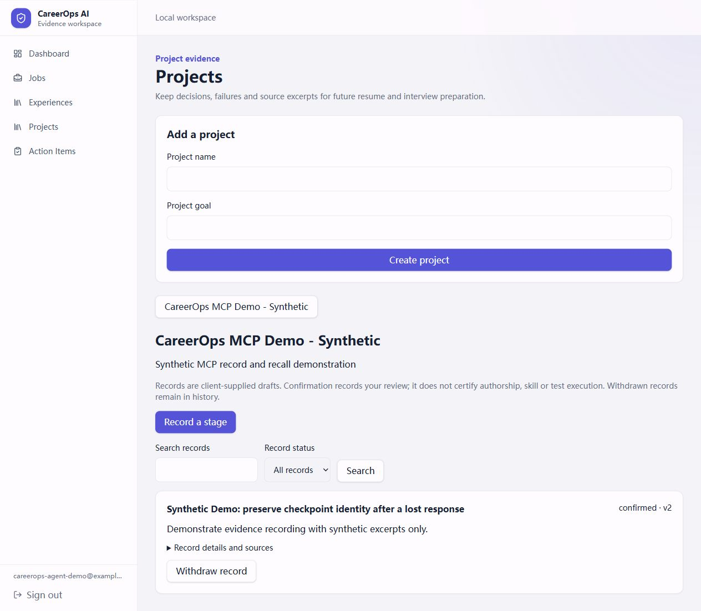

# CareerOps AI

Turn project work into evidence you can use in job applications and interviews.

CareerOps helps CS students keep track of what they built, match their experience
to job requirements, and prepare material grounded in their actual work. It
combines an application workspace with a project journal that coding assistants
can use through MCP and a Skill.

## Why this exists

When it's time to apply, reconstructing a project from code and old conversations
is slow. Design decisions, failed approaches and verification results are easy
to lose. A job description can also reveal gaps without making the next step clear.

CareerOps keeps those details with their sources, makes gaps visible, and helps
turn reviewed evidence into preparation tasks and resume or interview drafts.

## What you can do

| Capability | How it helps |
|---|---|
| Experience library | Add experience manually or import a CV into editable drafts for review. |
| Job preparation | Save a job description, parse requirements, and review supporting experience and gaps. |
| Project journal | Record changes, decisions, failures and verification with selected source excerpts. |
| Coding-assistant integration | Save checkpoints through MCP and a Skill; retrieve them in a later session. |
| Review and progress | Confirm your contribution, withdraw records, create tasks and track applications. |

For project recording, the model runs in your existing coding assistant.
CareerOps does not collect its model API key. Saved records start as drafts;
you review the sources and your contribution before confirming them.

## Demo

This local flow was exercised with real Codex sessions and a synthetic project:

1. **Record:** Codex calls MCP tools to create a project and save a checkpoint.
2. **Review:** Open Projects, inspect sources, and confirm the contribution statement.
3. **Recall:** A fresh Codex session retrieves the confirmed record and produces
   a cited project review, resume candidate bullet and STAR draft.



The screenshot shows the actual local app with synthetic data. The generated
material keeps that label and does not present it as a real personal achievement.
See the [demo walkthrough](docs/learning/0050-project-agent-demo.md) and
[fresh-session output](docs/metrics/2026-10-27-project-agent-host-recall-output.md).

## Run locally

Install Git and Docker with Docker Compose, then run:

```sh
git clone https://github.com/a6learner/careerops-ai.git
cd careerops-ai
docker compose --env-file .env.example -f docker-compose.yml -f docker-compose.acceptance.yml up -d --build
```

Open **http://127.0.0.1:3000** and create a local account. Database migrations run
as part of startup. The first build also installs the document-conversion tools.

This command uses deterministic fake backend providers, so no model API key is
needed to explore the UI and application workflow. Generated parse/match results
in this mode are demo outputs.

To try it:

1. Add an experience in **Experiences** and a target job in **Jobs**.
2. Parse the job, run analysis, and review the evidence and gaps.
3. Create preparation tasks in **Action Items** and follow progress in **Dashboard**.
4. In **Projects**, save a development stage, inspect its sources, and review it.

For coding-assistant recording and recall, follow the
[local agent setup](docs/product/project-agent-local-usage.md). The protected
client currently requires Windows and a separate terminal login. The coding
host uses its own model account and usage allowance.

Stop the local stack with `docker compose down`; the database volume is retained.

## Current scope

The application workflow and the Codex project-journal integration have been
verified locally. The project is a local prototype; production deployment and
broader real-project quality evaluation remain pending.

- Recording is triggered by a user request or Skill workflow; automatic background capture is not implemented.
- Confirming a record records your review; it does not certify authorship, skill or test execution.
- Job discovery currently uses a fake provider. Live job-search coverage is not available.
- Learning-plan generation, learning-resource search and Notion sync are planned work.
- Claude Code configuration examples are provided; its live integration has not been verified.

## Built with

Python · FastAPI · PostgreSQL/pgvector · Redis/Dramatiq · Next.js · MCP · Docker

The backend separates API requests from worker-side model calls. Evidence checks,
database constraints and retry-safe operations support the application workflow.

For development commands and technical details, see the
[development guide](docs/development.md). Design explanations and knowledge checks
live in [learning notes](docs/learning/README.md).
