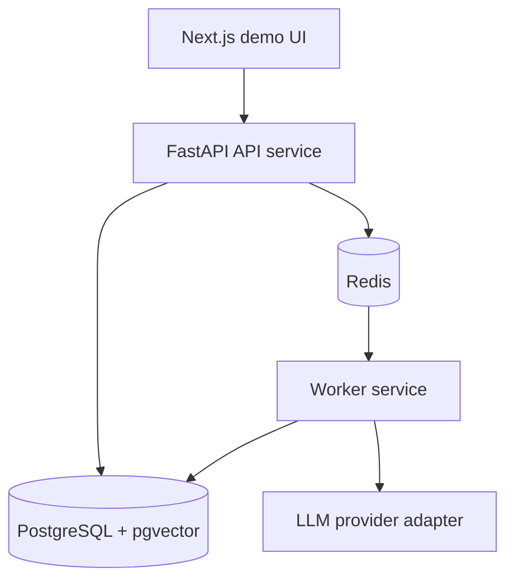

# CareerOps AI

CareerOps AI is a backend-first project for matching internship job requirements against a student's real experience evidence. The product uses AI, but the engineering focus is reliability: asynchronous work, idempotency, database constraints, caching, observability, and repeatable tests.

## Current Status

This repository is at the project skeleton stage. The first milestone creates a small FastAPI service with health endpoints, local PostgreSQL and Redis dependencies, strict typing, import boundary checks, and CI scaffolding.

## Architecture Direction



The API service will never call the LLM directly. Model calls belong in the worker so request latency stays predictable and tests can replace the provider with a fake implementation.

## Local Setup

Create a virtual environment, install dependencies, then run the API:

```powershell
python -m venv .venv
.\.venv\Scripts\Activate.ps1
python -m pip install -e ".[dev,worker]"
uvicorn careerops.main:create_app --factory --reload
```

Start local infrastructure:

```powershell
docker compose up -d postgres redis
```

Useful checks:

```powershell
pytest
mypy
ruff check .
lint-imports
```

## API Surface

- `GET /healthz` checks whether the API process is alive.
- `GET /readyz` checks whether required dependencies are reachable.

Business endpoints will be added in small milestones: auth, experiences, jobs, async parse runs, async analysis runs, action items, and dashboard summary.

## Key Decisions

- Python is used with strict typing discipline because the project targets backend systems plus LLM governance, not a language showcase.
- PostgreSQL is the only source of truth. Redis may be cleared and rebuilt.
- Dramatiq is the planned worker queue because its Redis integration is small and direct for this project size; the queue choice can still be revisited before the async milestone.
- Database constraints will enforce core invariants, especially the rule that positive evidence matches cannot be stored without real evidence.
