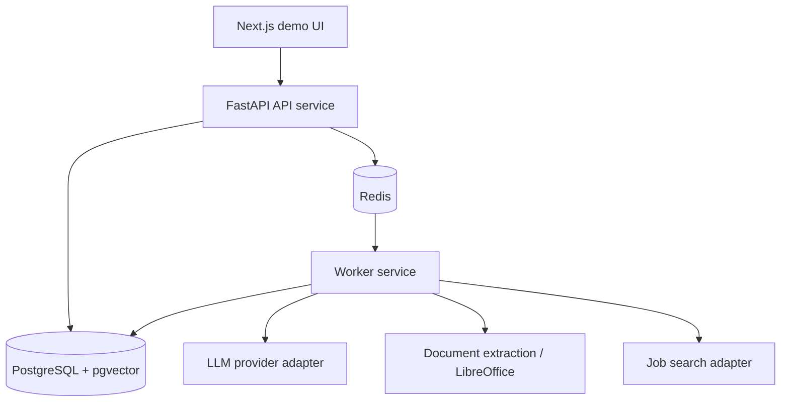

# Development Guide

Commands below run from the repository root unless stated otherwise.
For a product overview and the basic Docker startup, see [README](../README.md).
Historical evaluation commands are retained for reference; the frozen embedding
and matcher holdouts are closed and must not be rerun or tuned.

## Architecture Direction



The API service will never call the LLM directly. Model calls belong in the worker so request latency stays predictable and tests can replace the provider with a fake implementation.

The worker image includes LibreOffice for DOC, ODT, and RTF conversion. A
host-run worker needs `soffice` available on `PATH` to process those formats;
PDF, DOCX, TXT, and Markdown use Python extractors directly. Encrypted PDFs,
suspicious office archives, non-UTF-8 text, empty documents, and files larger
than 5 MiB are rejected. Scanned PDFs report that no usable text was found.

## Local Setup

Create a project-local virtual environment:

```powershell
python -m venv .venv
.\.venv\Scripts\python -m pip install -e ".[dev,worker,agent]"
```

Run the API through the virtual environment:

```powershell
.\.venv\Scripts\uvicorn careerops.main:create_app --factory --reload
```

Run the local Next.js frontend in a second terminal:

```powershell
Set-Location frontend
Copy-Item .env.example .env.local
npm install
npm run dev
```

Open `http://127.0.0.1:3000`. Keep the browser, frontend, and API on the
documented `127.0.0.1` host spelling so the host-only session cookie and local
service URLs stay predictable.

The browser calls only same-origin Next.js Route Handlers. Login stores the
backend access token in an HttpOnly, SameSite=Lax cookie, and the server-side
proxy adds the bearer header when forwarding an allowlisted API request. The
token is never stored in browser JavaScript or local storage. The local cookie
is not `Secure` because the documented development URL uses HTTP; production
sets `Secure` and requires HTTPS. `CAREEROPS_API_BASE_URL` is server-only and
must not be renamed with a `NEXT_PUBLIC_` prefix.

The backend has no refresh-token endpoint. Session expiry clears the frontend
cookie after a backend 401 and requires another login. ADR-039 records why a
refresh/session lifecycle was deferred instead of adding an unsafe partial
implementation.

Run the frontend quality gates:

```powershell
Set-Location frontend
npm run lint
npm run typecheck
npm test
npm audit --omit=dev
npm run build
```

The browser acceptance dependency is development-only. Install its pinned
Chromium once on a new workstation:

```powershell
Set-Location frontend
npx playwright install chromium
Set-Location ..
```

The full dependency audit currently reports an upstream development-only glob
parser advisory through `eslint-config-next`; the production dependency audit
is clean. Do not use `npm audit fix --force`, because its suggested downgrade is
incompatible with the selected Next.js release. Revisit the pin when the Next.js
ESLint dependency chain publishes a compatible patched release.

Start local infrastructure:

```powershell
docker compose up -d postgres redis
```

Run the complete containerized stack from a clean checkout:

```powershell
docker compose up -d --build
docker compose ps
Invoke-RestMethod http://127.0.0.1:8000/healthz
Invoke-RestMethod http://127.0.0.1:8000/readyz
Invoke-RestMethod http://127.0.0.1:3000/healthz
Invoke-RestMethod http://127.0.0.1:3000/readyz
```

The one-shot `migrate` container must finish successfully before `api` and
`worker` start. The API readiness check requires both PostgreSQL and Redis, and
frontend readiness delegates to that API check. The browser calls only the
Next.js origin; the BFF reaches FastAPI over the Compose network at
`http://api:8000`. `CAREEROPS_FRONTEND_ORIGIN` must exactly match the public URL
used by the browser when a non-default frontend port is selected. Stop the stack
without deleting PostgreSQL data using `docker compose down`; add `-v` only when
intentionally deleting the local Compose database.

For reproducible local browser acceptance, use the harness instead of the ordinary
development command. It creates a unique Compose project, refuses occupied
ports or pre-existing project resources, overrides all three providers to
`fake` even when the ignored root `.env` selects a real provider, runs the full
Chromium core loop, and removes only that project's containers, network, and
volume in `finally`:

```powershell
.\scripts\local_full_stack_acceptance.ps1 -RunId localcheck
```

Run the same fake-provider browser flow at presentation pace. The browser phase
must finish between three and five minutes:

```powershell
.\scripts\local_full_stack_acceptance.ps1 -RunId demo-check -DemoRehearsal
```

The narration and checkpoints are in `docs/demo/p0-demo-script.md`.

The default isolated ports are PostgreSQL `15410`, Redis `16310`, API `18010`,
and frontend `13010`. Override the script parameters if any are occupied. Do not
use the acceptance cleanup command against an ordinary development or production
Compose project.

Measure the main authenticated read endpoints with 5,000 synthetic Jobs in a
separate disposable database:

```powershell
.\scripts\local_read_endpoint_benchmark.ps1 `
  -RunId localcheck `
  -EvidenceName 2026-10-10-read-endpoint-performance-reproduction
```

The harness uses 25 warmups and 200 nearest-rank percentile samples per ordinary
scenario, checks full cursor traversal and insertion stability, captures indexed
and unindexed query plans, refuses to overwrite evidence files, and deletes only
its exact Compose project. The saved 2026-10-10 results are local sequential
measurements, not production capacity evidence.

Exercise only the supported latest migration rollback boundary in another
isolated database:

```powershell
.\scripts\local_migration_rollback_drill.ps1 -RunId localcheck
```

This performs `base -> head -> 202609190001 -> head`, verifies data preservation
and lifecycle-constraint restoration, and cleans up its own volume. It never
downgrades the development database.

`CAREEROPS_ENV=production` refuses the checked-in development JWT secret. A real
deployment must inject a separate `CAREEROPS_JWT_SECRET`; do not place it in the
repository or image. Platform-neutral release and rollback checks are documented
in `docs/operations/deployment-runbook.md`.

Run the worker in a separate terminal:

```powershell
.\.venv\Scripts\dramatiq careerops.workers.tasks --processes 1 --threads 4
```

Embedding and hybrid retrieval default to the deterministic fake provider. A local
Gemini worker requires `CAREEROPS_EMBEDDING_PROVIDER=gemini`, an ignored
`CAREEROPS_GEMINI_API_KEY`, and a process-only live gate that is never read from
`.env`:

```powershell
$env:CAREEROPS_RUN_EMBEDDING_INTEGRATION = "1"
try { .\.venv\Scripts\dramatiq careerops.workers.tasks --processes 1 --threads 4 }
finally { Remove-Item Env:CAREEROPS_RUN_EMBEDDING_INTEGRATION -ErrorAction SilentlyContinue }
```

The API still only schedules durable work; provider calls occur in the worker.

The checked-in `.env.example` defaults to the deterministic `fake` provider.
To run Groq locally, copy the example to the ignored `.env`, set
`CAREEROPS_LLM_PROVIDER=groq`, and add `CAREEROPS_LLM_API_KEY`. Never commit the
key. Automated tests remain fake or mock-backed unless the live-test flag is
explicitly enabled.

Evidence matching is configured independently from requirement parsing. Setting
`CAREEROPS_EVIDENCE_MATCHER_PROVIDER=groq` in the API process binds newly
submitted Analysis Runs to the frozen Groq matcher. It does not make a network
call. The worker additionally requires the process-only live gate:

```powershell
$env:CAREEROPS_RUN_REAL_MATCHER_WORKER = "1"
try { .\.venv\Scripts\dramatiq careerops.workers.tasks --processes 1 --threads 4 }
finally { Remove-Item Env:CAREEROPS_RUN_REAL_MATCHER_WORKER -ErrorAction SilentlyContinue }
```

The key may be loaded from the ignored `.env`, but putting the live gate there
does not authorize execution because the resolver reads it directly from the
worker process environment. Stop other unauthorized Analysis workers before
processing Groq-bound jobs; otherwise they will correctly claim and fail those
jobs as disabled. Each real matcher execution makes one HTTP attempt. A timeout,
429, 5xx, invalid JSON, invalid schema, or invalid contract becomes a durable
failure; there is no fake fallback or claimed process-wide TPM smoothing.

New Analysis Runs are admitted through a per-user Redis sliding window before a
durable row or queue message is created. The default allows five new runs per
hour. A valid `Idempotency-Key` replay returns its existing run without consuming
another slot. Rejection returns `429 ANALYSIS_RATE_LIMITED` with `Retry-After`;
Redis admission failure returns 503 instead of silently disabling cost
protection. Configure the window with `CAREEROPS_ANALYSIS_RATE_LIMIT` and
`CAREEROPS_ANALYSIS_RATE_LIMIT_WINDOW_SECONDS`.

Analysis lifecycle logs are valid JSON with an explicit safe-field allowlist.
Use `run_id` plus `attempt` to correlate durable work across duplicate delivery
and recovery. The validated HTTP `request_id` follows initial queue delivery;
recovery uses a new request ID because it is a separate invocation. Logs do not
contain job or Experience text, credentials, authorization tokens, idempotency
keys, or raw provider output.

Before rebuilding the Compose worker for `test_worker_e2e.py`, set
`CAREEROPS_LLM_PROVIDER=fake` in the same shell that runs `docker compose up`.
Also force parser, matcher, and embedding providers to fake in the host test
process. The test checks its own settings and the persisted fake model
identities, but it cannot configure an already-running worker process. Inspect
the recreated worker environment before dispatching test work; never rely on an
ambient developer `.env` for this offline check.

Run one bounded recovery pass across queued work and stale running work in
PostgreSQL. This operational entry point refuses to dispatch unless the parser,
embedding, and evidence-matcher provider settings in its process are all `fake`:

```powershell
.\.venv\Scripts\python -m careerops.workers.recovery_cycle
```

The command prints one JSON summary and exits nonzero when any recovery type has
an exception or Redis dispatch failure. It does not configure an already-running
worker, so verify that worker's three provider settings are also `fake` before
using this command. The individual commands remain available for diagnosis:

```powershell
.\.venv\Scripts\python -m careerops.workers.recovery
.\.venv\Scripts\python -m careerops.workers.analysis_recovery
.\.venv\Scripts\python -m careerops.workers.embedding_recovery
```

Preview the isolated worker recovery drill without creating resources:

```powershell
.\.venv\Scripts\python -m careerops.operations.worker_recovery_drill plan `
  --run-id 20261006t180000z_1a2b3c4d
```

The real drill requires an invocation-local gate and matching cleanup run ID. It
uses one sentinel-protected `careerops_p18b_*` database, one labeled temporary
Redis container, and a dedicated fake-only worker; it never uses the development
database, existing Redis data, or an existing worker:

```powershell
$env:CAREEROPS_RUN_WORKER_RECOVERY_DRILL = "1"
$drillExitCode = 1
try {
  .\.venv\Scripts\python -m careerops.operations.worker_recovery_drill run `
    --run-id 20261006t180000z_1a2b3c4d `
    --confirm-cleanup-run-id 20261006t180000z_1a2b3c4d
  $drillExitCode = $LASTEXITCODE
} finally {
  Remove-Item Env:CAREEROPS_RUN_WORKER_RECOVERY_DRILL -ErrorAction SilentlyContinue
}
if ($drillExitCode -ne 0) { exit $drillExitCode }
```

Apply database migrations:

```powershell
.\.venv\Scripts\alembic upgrade head
```

Preview the isolated P1-8a PostgreSQL backup/restore resources without creating a
database, directory, or dump:

```powershell
.\.venv\Scripts\python -m careerops.operations.backup_restore_drill plan `
  --run-id 20261006t120000z_1a2b3c4d
```

The planner accepts only its fixed temporary database namespace and system-temp
artifact root. It does not execute a backup, restore, cleanup, or provider call.

Run the synthetic drill only with separate author approval. The run ID and cleanup
confirmation must match exactly:

```powershell
$env:CAREEROPS_RUN_BACKUP_RESTORE_DRILL = "1"
$drillExitCode = 1
try {
  .\.venv\Scripts\python -m careerops.operations.backup_restore_drill run `
    --run-id 20261006t140000z_deadbeef `
    --confirm-cleanup-run-id 20261006t140000z_deadbeef
  $drillExitCode = $LASTEXITCODE
} finally {
  Remove-Item Env:CAREEROPS_RUN_BACKUP_RESTORE_DRILL -ErrorAction SilentlyContinue
}
if ($drillExitCode -ne 0) { exit $drillExitCode }
```

The command creates only derived `careerops_p18a_*` databases, migrates and seeds
the source with synthetic data, uses the Compose PostgreSQL 16 `pg_dump` and
`pg_restore`, verifies the restored data and read paths, and deletes the exact
sentinel-verified resources only after success. A failed run keeps its databases,
manifest, dump, and diagnostic file. Inspect those resources and obtain cleanup
authorization before using the `cleanup-failed` subcommand with the same run ID.
Redis is never backed up, and no model provider is called.

Useful checks:

```powershell
.\.venv\Scripts\python -m pytest
.\.venv\Scripts\python -m mypy
.\.venv\Scripts\ruff check .
.\.venv\Scripts\lint-imports
```

Run the small real-provider compatibility test intentionally:

```powershell
$env:CAREEROPS_RUN_LLM_INTEGRATION='1'
.\.venv\Scripts\python -m pytest tests/integration/test_groq_live.py -s
Remove-Item Env:CAREEROPS_RUN_LLM_INTEGRATION
```

Run the labeled development-set evaluation intentionally, always choosing a new
output filename so historical evidence remains intact:

```powershell
.\.venv\Scripts\python -m careerops.evaluation.run_requirement_parser `
  --dataset evals/job_requirements_v1.json `
  --output docs/metrics/YYYY-MM-DD-groq-requirement-eval.json `
  --git-revision <commit-or-working-tree-label>
```

Evaluate the current lexical evidence retriever offline, again choosing a new
output filename for every saved comparison:

```powershell
.\.venv\Scripts\python -m careerops.evaluation.run_evidence_retrieval `
  --dataset evals/evidence_retrieval_v1.json `
  --output docs/metrics/YYYY-MM-DD-lexical-retrieval-baseline.json `
  --git-revision <commit-or-working-tree-label>
```

Run retrieval evaluation v2 only with the approved manifest and development split:

```powershell
.\.venv\Scripts\python -m careerops.evaluation.run_evidence_retrieval_v2 `
  --experiences evals/evidence_retrieval_v2/experiences.json `
  --queries evals/evidence_retrieval_v2/development_queries.json `
  --review-manifest evals/evidence_retrieval_v2/review_manifest.json `
  --output docs/metrics/YYYY-MM-DD-lexical-retrieval-v2-development.json `
  --git-revision <commit-or-working-tree-label>
```

The command rejects holdout queries. Keep the holdout sealed until lexical, vector,
and hybrid candidates and parameters are frozen for their one-time comparison.

After author approval of rubric v2, run the development split with the
deterministic fake matcher:

```powershell
.\.venv\Scripts\python -m careerops.evaluation.run_evidence_matcher `
  --experiences evals/evidence_retrieval_v2/experiences.json `
  --cases evals/evidence_matcher_v1/development_cases.json `
  --review-manifest evals/evidence_matcher_v1/review_manifest.json `
  --output docs/metrics/YYYY-MM-DD-fake-evidence-matcher-development.json `
  --git-revision <commit-or-working-tree-label>
```

The checked-in manifest is `approved_frozen` for development hash
`c8c3d535ae103ea21b4c24397e1021dc4fd7688b37f907563363a19d87329605`.
Hash validation prevents changed labels from reusing that approval. The
development runner always rejects matcher holdout, and manifest approval alone
does not authorize a provider request.

Reproduce the rubric-v2 offline rescore from saved raw development output without
a provider call:

```powershell
.\.venv\Scripts\python -m careerops.evaluation.run_evidence_matcher_rescore `
  --experiences evals/evidence_retrieval_v2/experiences.json `
  --cases evals/evidence_matcher_v1/development_cases.json `
  --source-report docs/metrics/2026-10-04-groq-evidence-matcher-development-recovery.json `
  --output docs/metrics/YYYY-MM-DD-groq-evidence-matcher-offline-rescore.json `
  --git-revision <commit-or-working-tree-label>
```

The rescorer accepts development data only, refuses overwrite, records zero
provider attempts, and does not require or imply holdout access.

Derive coverage and directional safety metrics from an immutable development
report without calling a provider:

```powershell
.\.venv\Scripts\python -m careerops.evaluation.run_evidence_matcher_coverage_rescore `
  --experiences evals/evidence_retrieval_v2/experiences.json `
  --cases evals/evidence_matcher_v1/development_cases.json `
  --source-report docs/metrics/2026-10-04-groq-evidence-matcher-development-prompt-v2.json `
  --output docs/metrics/YYYY-MM-DD-evidence-matcher-coverage.json `
  --git-revision <commit-or-working-tree-label>
```

For user-facing explanations, say that current materials fully demonstrate,
partly demonstrate, or do not yet demonstrate a requirement. A missing resume
claim is not proof that the user lacks the ability. Suggest adding concrete
details only when the user genuinely performed the work; never suggest inventing
an Experience, technology, metric, or result.

Run a separately authorized, bounded Groq development evaluation only with an
invocation-local opt-in:

```powershell
$env:CAREEROPS_RUN_MATCHER_EVAL = "1"
.\.venv\Scripts\python -m careerops.evaluation.run_real_evidence_matcher `
  --experiences evals/evidence_retrieval_v2/experiences.json `
  --cases evals/evidence_matcher_v1/development_cases.json `
  --review-manifest evals/evidence_matcher_v1/review_manifest.json `
  --run-manifest evals/evidence_matcher_v1/prompt_v4_selected_development_manifest.json `
  --output docs/metrics/YYYY-MM-DD-groq-evidence-matcher-development.json `
  --git-revision <commit-or-working-tree-label>
```

The runner is fixed to `openai/gpt-oss-20b`, one attempt per case, at most 12
provider attempts, and an 800-token output ceiling. It refuses output overwrite
and the matcher holdout. No further development run is currently approved; the
command documents the frozen invocation rather than inviting another sample.
The 2026-10-04 run exhausted its budget with six durable
rate-limit failures; do not rerun the command as recovery because it would recall
the six successful cases.

The confirmed cause was the model's rolling 8K TPM limit, not TPD or monthly
exhaustion: the first six successes reported 7,648 tokens while requests were sent
in about nine seconds, and the account showed only about 8.2K daily tokens against
the 200K TPD allowance. Recovery therefore paces requests instead of changing the
frozen model, prompt, matcher labels, or retrieval parameters.

After separate authorization, recover only those failures with a new artifact:

```powershell
$env:CAREEROPS_RUN_MATCHER_EVAL = "1"
.\.venv\Scripts\python -m careerops.evaluation.run_real_evidence_matcher `
  --experiences evals/evidence_retrieval_v2/experiences.json `
  --cases evals/evidence_matcher_v1/development_cases.json `
  --review-manifest evals/evidence_matcher_v1/review_manifest.json `
  --resume-from docs/metrics/2026-10-04-groq-evidence-matcher-development.json `
  --output docs/metrics/YYYY-MM-DD-groq-evidence-matcher-development-recovery.json `
  --git-revision <commit-or-working-tree-label>
```

Recovery hash-validates the original report, calls only failed case IDs, limits
the new budget to their count, spaces requests by at least 11 seconds, and carries
successful prior results into the new report. It still rejects holdout input.

The authorized 2026-10-04 recovery used all six allowed requests and completed
without failure. The merged development result is documented under
`docs/metrics/2026-10-04-groq-evidence-matcher-development-recovery.md`. Do not
repeat the recovery: there are no failed cases left, and the runner will reject a
prior report with nothing to recover.

The later prompt-v2 development report is documented in
`docs/metrics/2026-10-04-groq-evidence-matcher-development-prompt-v2.md`. It has
one `invalid_schema` case and did not pass the frozen gates. Do not run another
fresh development pass or recover that case without separate authorization; no
matcher holdout run is authorized.

The one-time matcher holdout used a separate runner and opt-in. The command below
is retained only to document the frozen invocation; the holdout completed on
2026-10-05 and must not be run again:

```powershell
$env:CAREEROPS_RUN_MATCHER_HOLDOUT = "1"
.\.venv\Scripts\python -m careerops.evaluation.run_evidence_matcher_holdout `
  --experiences evals/evidence_retrieval_v2/experiences.json `
  --development-cases evals/evidence_matcher_v1/development_cases.json `
  --holdout-cases evals/evidence_matcher_v1/holdout_cases.json `
  --manifest evals/evidence_matcher_v1/holdout_v2_run_manifest.json `
  --selected-development-manifest evals/evidence_matcher_v1/prompt_v4_selected_development_manifest.json `
  --development-report docs/metrics/2026-10-05-groq-evidence-matcher-development-prompt-v4.json `
  --development-coverage-report docs/metrics/2026-10-05-groq-evidence-matcher-development-prompt-v4-coverage-v2-gates-v4.json `
  --checkpoint docs/metrics/2026-10-05-groq-evidence-matcher-holdout-checkpoint.json `
  --output docs/metrics/2026-10-05-groq-evidence-matcher-holdout.json `
  --git-revision <commit-or-working-tree-label>
```

The manifest freezes eight request slots, one attempt per case, prompt v4, Groq
`openai/gpt-oss-20b`, at least 11 seconds between requests, and the coverage-v2
evaluator. Resume skips completed cases. A case that was in progress during a
local interruption becomes an explicit indeterminate provider failure and is not
called again. Provider/output failures never become gaps. All safety gates
passed. Matcher-only coverage was 6/8 and both partial cases became gaps, so
quality remains limited even though worker integration is allowed.

Exercise the embedding evaluation pipeline offline with its deterministic fake provider:

```powershell
.\.venv\Scripts\python -m careerops.evaluation.run_embedding_retrieval_v2 `
  --experiences evals/evidence_retrieval_v2/experiences.json `
  --queries evals/evidence_retrieval_v2/development_queries.json `
  --review-manifest evals/evidence_retrieval_v2/review_manifest.json `
  --lexical-baseline docs/metrics/2026-09-21-lexical-retrieval-v2-development.json `
  --cache "$env:TEMP\p1-3a-fake-cache.json.gz" `
  --output "$env:TEMP\p1-3a-fake-comparison.json" `
  --git-revision <commit-or-working-tree-label> `
  --provider fake
```

Run the real Gemini development evaluation only after explicit authorization. Use
new cache and output filenames, verify the active Google AI Studio project quota,
and send only the checked-in synthetic data. Store the key only in the ignored
repository-root `.env` file:

```dotenv
CAREEROPS_GEMINI_API_KEY=<paste-the-key-here>
```

Do not put the key in `.env.example`, a command, source code, or chat. The key is
read from `.env`; the one-run opt-in remains a temporary environment variable:

```powershell
$env:CAREEROPS_RUN_EMBEDDING_EVAL='1'
.\.venv\Scripts\python -m careerops.evaluation.run_embedding_retrieval_v2 `
  --experiences evals/evidence_retrieval_v2/experiences.json `
  --queries evals/evidence_retrieval_v2/development_queries.json `
  --review-manifest evals/evidence_retrieval_v2/review_manifest.json `
  --lexical-baseline docs/metrics/2026-09-21-lexical-retrieval-v2-development.json `
  --cache docs/metrics/YYYY-MM-DD-gemini-embedding-2-development-vectors.json.gz `
  --output docs/metrics/YYYY-MM-DD-gemini-embedding-2-development-comparison.json `
  --git-revision <commit-or-working-tree-label> `
  --provider gemini
Remove-Item Env:CAREEROPS_RUN_EMBEDDING_EVAL
```

The Gemini path is disabled unless both the explicit flag and key are present. It
uses one document batch and one development-query batch with one attempt each,
requires exactly 1536 finite non-zero vectors, refuses output overwrite, and never
accepts the holdout split.

The one-time holdout runner is separate from development evaluation. Do not run it
without explicit holdout authorization. It verifies the committed development
report and vector-cache hashes, reuses the 40 frozen document vectors, and submits
only the 20 synthetic holdout queries in one single-attempt batch. The vector threshold `0.65`, hybrid
threshold `0.65`, and hybrid lexical weight `0.50` cannot be overridden:

```powershell
$env:CAREEROPS_RUN_EMBEDDING_HOLDOUT='1'
.\.venv\Scripts\python -m careerops.evaluation.run_embedding_holdout_v2 `
  --experiences evals/evidence_retrieval_v2/experiences.json `
  --holdout-queries evals/evidence_retrieval_v2/holdout_queries.json `
  --review-manifest evals/evidence_retrieval_v2/review_manifest.json `
  --frozen-development-report docs/metrics/2026-10-01-gemini-embedding-2-development-comparison.json `
  --frozen-development-cache docs/metrics/2026-10-01-gemini-embedding-2-development-vectors.json.gz `
  --cache docs/metrics/YYYY-MM-DD-gemini-embedding-2-holdout-queries.json.gz `
  --output docs/metrics/YYYY-MM-DD-gemini-embedding-2-holdout-comparison.json `
  --git-revision <commit-or-working-tree-label>
Remove-Item Env:CAREEROPS_RUN_EMBEDDING_HOLDOUT
```

The holdout runner has no fake CLI mode and no parameter grid. Default tests use
development-derived toy queries marked as holdout, not the real holdout file. A
provider failure saves an incomplete query cache and writes no comparison report.

Using the explicit `.venv` paths keeps project dependencies out of the global Python or Anaconda environment.

## API Surface

Project journal endpoints use the same authentication boundary:
`/api/v1/projects`, `/api/v1/projects/{project_id}/checkpoints`, individual
checkpoint reads and checkpoint `/review`. Full request schemas are available
in the running API's `/docs`. Local MCP/CLI setup is described in
[the agent guide](product/project-agent-local-usage.md).

- `GET /healthz` checks whether the API process is alive.
- `GET /readyz` checks PostgreSQL and Redis concurrently. It returns `200` with
  `{"status":"ready","database":true,"redis":true}` only when both are
  reachable; otherwise it returns `503` with each dependency's boolean state.
- `POST /api/v1/auth/register` creates a user with a hashed password.
- `POST /api/v1/auth/login` verifies credentials and returns a bearer access token.
- `GET /api/v1/auth/me` returns the current user for a valid bearer access token.
- `GET /api/v1/experiences` lists the current user's active experiences.
- `POST /api/v1/experiences` creates an experience owned by the current user.
- `GET /api/v1/experiences/{id}` returns one owned active experience.
- `PATCH /api/v1/experiences/{id}` updates one owned active experience with `If-Match` optimistic locking.
- `DELETE /api/v1/experiences/{id}` soft-deletes one owned active experience.
- `GET /api/v1/jobs` lists the current user's active jobs with optional status filtering and cursor pagination.
- `POST /api/v1/jobs` creates a target job description owned by the current user.
- `GET /api/v1/jobs/{id}` returns one owned active job.
- `PATCH /api/v1/jobs/{id}` updates one owned active job with `If-Match` optimistic locking.
- `DELETE /api/v1/jobs/{id}` soft-deletes one owned active job.
- `POST /api/v1/jobs/{id}/parse-runs` creates or reuses a queued idempotent parse run for one owned active job; a key can be replayed only while that job's parse input is unchanged.
- `GET /api/v1/jobs/{id}/parse-runs/{run_id}` returns one owned parse run with structured requirements.
- `POST /api/v1/jobs/{id}/analysis-runs` creates or reuses a queued idempotent Analysis Run for an explicit successful Parse Run and the current active experience-library fingerprint; only new runs consume the per-user admission window.
- `GET /api/v1/jobs/{id}/analysis-runs/{run_id}` returns one owned Analysis Run with validated evidence matches and explicit gaps.
- `GET /api/v1/action-items` lists owned tasks with optional Job/status filters and cursor pagination, including archived-Job state.
- `POST /api/v1/action-items` idempotently creates a manual task or one linked to an actionable Evidence Match.
- `PATCH /api/v1/action-items/{id}` updates title or status with `If-Match` optimistic locking, including after its Job is archived.
- `GET /api/v1/dashboard/summary` returns the current user's active Job and Action Item status totals, cached in Redis with PostgreSQL fallback.

The backend MVP core loop reaches the Dashboard summary. Local Analysis Runs use
exact hybrid retrieval and either the default deterministic fake matcher or the
explicitly authorized frozen Groq matcher inside the worker, while preserving
lexical fallback, object-level authorization, evidence validation, and atomic
result writes.

## Key Decisions

- Python is used with strict typing discipline because the project targets backend systems plus LLM governance, not a language showcase.
- PostgreSQL is the only source of truth. Redis may be cleared and rebuilt.
- Dramatiq is the worker queue because its Redis integration is small and direct for this project size. PostgreSQL remains the durable task source and can rebuild queued delivery.
- Database constraints will enforce core invariants, especially the rule that positive evidence matches cannot be stored without real evidence.
