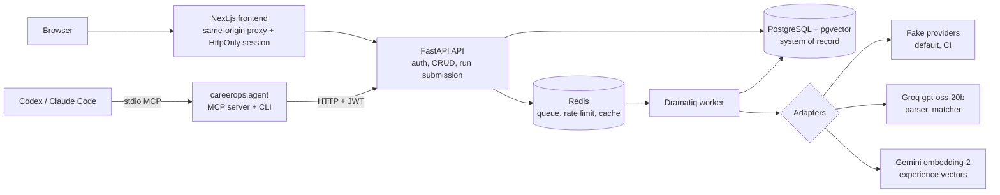

# CareerOps AI: Project Walkthrough

This document explains the whole system as it exists in code after the 2026-10-31
walkthrough and the parse-v3 fix (ADR-046). It was written from a fresh code read
and a real test run, not from older docs. Where an older doc disagrees with this one, the code and the saved test
record win.

- Test evidence for this walkthrough:
  [`docs/metrics/2026-10-31-real-data-walkthrough-test-record.md`](../metrics/2026-10-31-real-data-walkthrough-test-record.md)
- Current P0 evidence matrix: [`docs/P0_EVIDENCE_AND_LIMITATIONS.md`](../P0_EVIDENCE_AND_LIMITATIONS.md)
- Design decisions: [`docs/decisions/`](../decisions/) (ADR-001 to ADR-045)

## 1. What CareerOps is

CareerOps helps a CS student connect each requirement in a job description to real
evidence from their own experience, and mark everything else as a gap. It also
keeps a project journal that a coding assistant can write to through MCP.

**Honest positioning:** CareerOps is an AI-integrated backend. Its engineering
center is the reliability boundary around an unreliable LLM. It is **not** an
agent system today. In the live product, the model is called in exactly two
places, each as one single-shot structured call inside a worker job. The model
never chooses actions, calls tools or retries with feedback.

## 2. Architecture

The hard rules, enforced in code:

- The API never calls a model. Model calls happen in worker actors
  (`src/careerops/workers/tasks.py`).
- PostgreSQL holds every durable fact. Redis holds only the queue, the rate-limit
  window and a 30 s dashboard cache, and all of it can be thrown away.
- Every provider sits behind an adapter with a deterministic fake. All defaults are
  `fake` (`src/careerops/core/config.py`).
- Layering is API → service → repository, checked by import-linter.

## 3. End-to-end trace of the core loop

Each step lists the endpoint, what is written, where a model is involved, and
which checks apply.

### 3.1 Register and login

- `POST /api/v1/auth/register`, `POST /api/v1/auth/login`, `GET /api/v1/auth/me`.
- Passwords are hashed with Argon2id (ADR-004). Login returns an HS256 JWT valid
  for 30 minutes. There is no refresh token (ADR-039). Wrong email and wrong
  password return the same 401.
- The frontend stores the JWT in an HttpOnly cookie and proxies API calls through
  same-origin route handlers (ADR-037).

### 3.2 Build the experience library

- Manual entry: Experience CRUD at `/api/v1/experiences`. Updates need `If-Match`
  with the current version (optimistic locking, ADR-008).
- CV import: `POST /api/v1/cv-imports` (worker actor `execute_cv_import`). Text is
  extracted with pypdf, python-docx or LibreOffice. The text is then **split on
  blank lines into drafts. No model is used**
  (`services/assisted_imports.py`, `extract_experience_drafts`). Each draft keeps
  exact source offsets, and nothing becomes an Experience until the user confirms
  it.
- Confirming or editing an Experience queues an embedding run (`execute_embedding_run`).
  Vectors are stored with a content hash, so stale vectors are never used.

### 3.3 Save a job

- Job CRUD at `/api/v1/jobs` with cursor pagination (ADR-009). The read-endpoint
  P50/P95 at 5,000 rows is saved in `docs/metrics/2026-10-10-read-endpoint-performance.md`.

### 3.4 Parse requirements (model call 1)

- `POST /api/v1/jobs/{id}/parse-runs` returns 202 and needs an `Idempotency-Key`.
  The worker actor is `execute_parse_run`.
- **Code splits the job description into sentences first**
  (`extract_source_candidates`). Dots inside decimals and abbreviations such as
  "e.g." don't count as sentence ends. The model receives only
  `{candidate_id, text}` pairs. For each requirement it picks, it returns a
  category and one `skill_normalized`.
- **Requirement text always comes from the source span, never from the model.**
  - If the model returns the same sentence once per listed skill, the repeats merge
    into one requirement; the first category and first skill are kept (parse-v3,
    ADR-046).
  - Unknown candidate IDs, or spans that don't match the source, fail the run with
    `PARSER_OUTPUT_INVALID`. The reason is logged and token usage is stored on the
    failed run.

### 3.5 Match requirements to evidence (model call 2)

`POST /api/v1/jobs/{id}/analysis-runs` (`execute_analysis_run`):

1. **Admission:**
   - Fingerprint: SHA-256 of the parse run, the pipeline version and every
     Experience's `id:version:content_hash`.
   - Idempotency key: the same key with the same fingerprint replays; with a
     different fingerprint it returns a conflict.
   - Rate limit: a per-user Redis sliding window, 5 per hour by default. It fails
     closed if Redis is down (ADR-031).
2. **Claim:** a conditional `UPDATE … WHERE status='queued'` moves the run to
   `running`. Then the worker checks that the model and prompt pinned on the run
   still match the matcher, and recomputes the fingerprint
   (`ANALYSIS_INPUT_CHANGED` if anything changed).
3. **Retrieval (no model):** the top 5 candidate Experiences per requirement, by
   lexical score fused with pgvector cosine (threshold 0.65, weighted RRF k=60).
   With fake embeddings this is effectively lexical only.
4. **One matcher call for all requirements:** Groq with a strict JSON schema at
   temperature 0. Each requirement gets `matched` / `partial` /
   `insufficient_evidence` / `missing`. Positive verdicts must cite
   `{experience_id, version, source_ref, quote}`.
5. **Three validation layers:**
   - **Schema:** provider JSON schema plus a Pydantic discriminated union.
   - **Contract and citation checks:**
     - The output must contain exactly one verdict per requirement, otherwise the
       whole run fails with `MATCHER_OUTPUT_INVALID_CONTRACT`.
     - Each citation must point to an Experience that exists, belongs to the user,
       was in that requirement's candidate set, has the current version, and
       contains the quote as an exact substring.
     - A citation that fails any of these is **downgraded to
       `insufficient_evidence`** and counted in `validation_failure_count`.
   - **Database:** `ck_evidence_matches_grounded_verdict`. A positive verdict must
     carry an experience, a version, a non-blank quote and `quote_valid = true`. A
     gap must carry none. The substring and ownership checks themselves live in
     application code; the DB enforces the shape and the flag.
6. **Fenced write:** `UPDATE … WHERE status='running' AND attempt=:attempt`, so a
   stale worker cannot overwrite a newer attempt.

### 3.6 Review, tasks and dashboard

- The job page shows requirements, quoted evidence and gaps
  (`GET …/analysis-runs/latest`).
- Action Items come from gaps; `POST /api/v1/action-items` needs an idempotency key.
- The dashboard's summary is cached in Redis for 30 s and falls back to Postgres;
  the focus view is read directly (ADR-017, ADR-045).

### 3.7 Project journal (side path)

- `careerops.agent` is an MCP server with 8 tools, plus a CLI. An external coding
  assistant (Codex, Claude Code) drives it. CareerOps itself runs no model here.
- Packets are stored locally under Windows DPAPI, uploaded idempotently, and
  checked against the server's receipt.
- Checkpoints start as drafts, and confirming one needs a contribution note.
- **Checkpoints are not connected to Experiences or matching.**

### 3.8 Failure handling and recovery

- Every run has a typed error code: `PARSER_*`, `MATCHER_PROVIDER_*`,
  `MATCHER_OUTPUT_INVALID_*`, `ANALYSIS_INPUT_CHANGED`.
- Runs stuck in `running` past 300 s can be requeued with `attempt + 1`
  (`FOR UPDATE SKIP LOCKED`) by `python -m careerops.workers.recovery_cycle`.
- Limits of the recovery cycle:
  - Nothing schedules it; it runs only when invoked.
  - It refuses to run unless every provider is fake.
  - It does not cover CV import or job discovery.
- The real matcher makes one attempt with no Dramatiq retry, so a provider 429
  ends the run.

## 4. Component map

| Layer | Location | Contents |
|---|---|---|
| API | `src/careerops/api/` | auth, experiences, jobs, parse_runs, analysis_runs, action_items, dashboard, assisted_imports, project_records |
| Services | `src/careerops/services/` | business rules, run execution, validation, hybrid retrieval |
| Domain | `src/careerops/domain/` | pure types and functions (evidence matching, retrieval scoring) |
| Repositories | `src/careerops/repositories/` | SQLAlchemy queries, claims, fenced writes |
| Adapters | `src/careerops/adapters/` | fake/Groq parser, fake/Groq matcher, fake/Gemini embeddings, fake job search, document extraction, Redis rate limiter |
| Workers | `src/careerops/workers/` | Dramatiq actors, dispatcher, recovery CLIs |
| Evaluation | `src/careerops/evaluation/`, `evals/` | offline runners and frozen datasets |
| Agent | `src/careerops/agent/`, `integrations/` | MCP server, CLI, DPAPI store, Skill |
| Frontend | `frontend/src/app/` | login/register, dashboard, jobs, job detail, experiences, projects, action items |

## 5. What it does that one ChatGPT prompt cannot

| One prompt ("here is my CV and a JD, match them") | CareerOps |
|---|---|
| The model can rephrase or invent requirement text | Requirement text is sliced from the source; the model only picks sentences |
| The model can cite things the CV never says | Each quote must be an exact substring of an owned, current, candidate Experience, or it is downgraded |
| Nothing stops an unsupported "you have X" | A DB CHECK refuses positive verdicts without a validated citation |
| Results vanish when the chat ends, and a rerun gives different output | Runs are persisted, fingerprinted, idempotent and versioned by prompt and model |
| A slow or failed model call blocks the user | Calls run in a worker; the API returns 202 and failures get typed codes |
| No memory across jobs or over time | Experience library, job board, tasks and dashboard |
| Can't be tested without the model | Fake providers make CI deterministic and free |

Equally honest: on matching *quality*, a strong model given one good prompt may
currently surface more partial evidence than CareerOps, because CareerOps is
built to under-claim (see section 7).

## 6. Hard problems that were solved

| Problem | Decision | Failure it prevents | Evidence |
|---|---|---|---|
| Real JDs list several skills per sentence and the model repeats the sentence | Merge repeated IDs (text still from source); decimal/abbreviation-aware splitter; logged failure reason and tokens | Whole parse rejected by one sentence; fragmented requirements; invisible failures | ADR-046, walkthrough test record |
| Double submit or client retry creates duplicate runs | Idempotency key + request fingerprint + unique index | Duplicate cost and results; a reused key silently pointing at different input | ADR-015, `tests/integration/test_analysis_runs_postgres.py` |
| A stuck worker resumes after recovery and writes old results | Attempt fence on completion | Stale-worker overwrite | ADR-035, `docs/metrics/2026-10-06-worker-recovery-cycle-drill.md` |
| Two workers grab the same job | Conditional-UPDATE claim; SKIP LOCKED recovery | Double execution | ADR-011, ADR-035 |
| The model rewrites or invents requirement text | Model picks candidate IDs; text comes from source spans | Hallucinated requirements | ADR-012, `docs/metrics/2026-09-08-groq-requirement-eval-summary.md` |
| The model claims evidence the user doesn't have | Three-layer validation; downgrade to `insufficient_evidence` | Unsupported resume claims | ADR-014, ADR-030, holdout: 0 unsupported positives |
| Tuning on the test set | Frozen holdouts, run once, never reused | Inflated metrics | ADR-022, ADR-029 |
| Runaway model cost | Per-user Redis sliding window, fail-closed | Cost spikes when Redis is down | ADR-031 |
| Lost updates when editing | `If-Match` optimistic locking | Silent overwrites | ADR-008 |
| Slow pagination at scale | Keyset cursor pagination | OFFSET scans | ADR-009, read-endpoint benchmark |
| Agent uploads silently duplicated or altered | uuid5 packet IDs, SHA-256, receipt verification | Duplicate or tampered checkpoints | ADR-042 |

## 7. Open problems (measured)

From earlier saved evaluations:

- **Under-claiming.** Partial-evidence recall was 0/2 on the frozen matcher holdout,
  and canonical quote agreement was 0/3
  (`docs/metrics/2026-10-05-groq-evidence-matcher-holdout.md`).
- **Small synthetic evaluation sets.** The matcher holdout has 8 cases, the
  retrieval holdout 20 queries, the parser dev set 12 cases. All holdouts are used up.
- **Hybrid search is worse at saying "nothing matches".** Negative accuracy@5 was
  0.40 for hybrid vs 0.80 for vector only
  (`docs/metrics/2026-10-03-gemini-embedding-2-holdout.md`).

From the 2026-10-31 real-data walkthrough (n = 3 real JDs, one real CV; see the
test record):

- **Fixed: the real parser used to reject most full job descriptions.** Only 2 of
  17 parses passed.
  - Cause: multi-skill sentences made the model repeat a candidate ID, the strict
    duplicate check failed the whole run, and the splitter broke "3.5" and "e.g.".
  - After parse-v3 (ADR-046): 7 of 7 direct parses and 3 of 3 worker parse runs
    passed.
  - Lesson: the 12-case synthetic eval never contained such sentences.
- **Matcher under-claiming is now the main problem.**
  - After the fix, the real IDEMIA analysis returned `missing` for all 16
    requirements, including "Java, Python, C++" and "previous internship or project
    experience". The manual Experiences support both.
  - Earlier runs used `partial` 0 times out of 17, and confidence values were
    inconsistent.
  - No unsupported claim was observed in any run.
- **One matcher call does not scale to larger requirement sets.** Jobs with 10–17
  requirements failed `MATCHER_OUTPUT_INVALID_CONTRACT` in 3 of 4 attempts.
- **No retry on provider 429.** Back-to-back analyses mostly failed with
  `MATCHER_PROVIDER_RATE_LIMITED`.
- **CV import made one draft from a whole one-page CV.** The PDF had no blank lines.

Structural gaps:

- Project checkpoints never feed Experiences or matching.
- Job discovery is fake only.
- The recovery cycle is not scheduled and refuses real providers.
- There is no production deployment, monitoring or cost measurement.
- Matcher prompt v5 (`adapters/evidence_matcher_schema.py`) contains a broken
  sentence. It is not live; the worker only accepts v4. It is kept unchanged
  because saved evaluation results were produced with exactly that text.

## 8. Questions worth asking senior AI engineers

1. My parser failed closed on any duplicate sentence ID, which was safe but
   rejected real JDs. I changed it to merge repeats, because no model-written text
   is persisted. When do you repair model output, and when do you reject it? How do
   you keep a repair step from hiding real errors?
2. One matcher call for all requirements breaks as the job grows. Per requirement,
   batched, or an agent loop: how do you pick, given cost and rate limits?
3. My matcher never overclaims but almost never says "partial". How do you tune the
   safety/recall trade-off when false positives are much worse than misses?
4. My synthetic eval passed 12/12 while real JDs failed 15/17 before the fix. How do you build eval
   sets that match the real input distribution without leaking test data?
5. How do you monitor a model in production when CI only uses fakes?

## 9. Where AI or an agent could go next

These are options for the author to choose from, not commitments. Each would need
its own ADR, a fake-provider test boundary, and a fresh evaluation set.

| Option | Problem it targets | Fit with hard constraints | Evaluation | Rough cost |
|---|---|---|---|---|
| ~~Fix the parser contract~~ (**done**, ADR-046). Follow-up: store every skill in a sentence (`skills_normalized`), and add multi-skill sentences to the parser dev set | 15/17 real parses rejected (now 7/7 pass) | Fits; no agent needed | Real JDs plus a new dev set | Small; the follow-up needs a migration and an API change |
| **Evidence Investigator loop in the worker:** per requirement, the model calls `search_experiences` / `read_source` / `submit_citation`; the validator answers each submission and the loop stops after N steps | Under-claiming (partial 0/2), quote misses, large-JD contract failures | Fits if it stays in the worker, uses a fake scripted provider in CI, and keeps the same validator and DB check | Fresh labeled set focused on partial evidence; compare against the single-call matcher | Medium–large; most "agentic" story |
| **Model-based CV extraction with grounded spans** (same approach as the parser) | One-draft CV import | Fits; draft review remains | Real CVs hand-labeled by the author | Small–medium |
| **Checkpoints → Experience drafts** | Journal evidence never reaches matching | Fits; user confirmation stays | Author review of drafts | Medium |
| **Gap-to-action planner** | Gaps don't become concrete next steps | Fits; output is tasks, not claims | Author judgment; weaker metrics | Medium |
| **Expanded MCP tools** (analysis, gaps, experiences) so an external host acts as the agent | Agent experience without owning the loop | Fits; no in-product model calls | Host demo | Small; the agent loop isn't CareerOps code |
